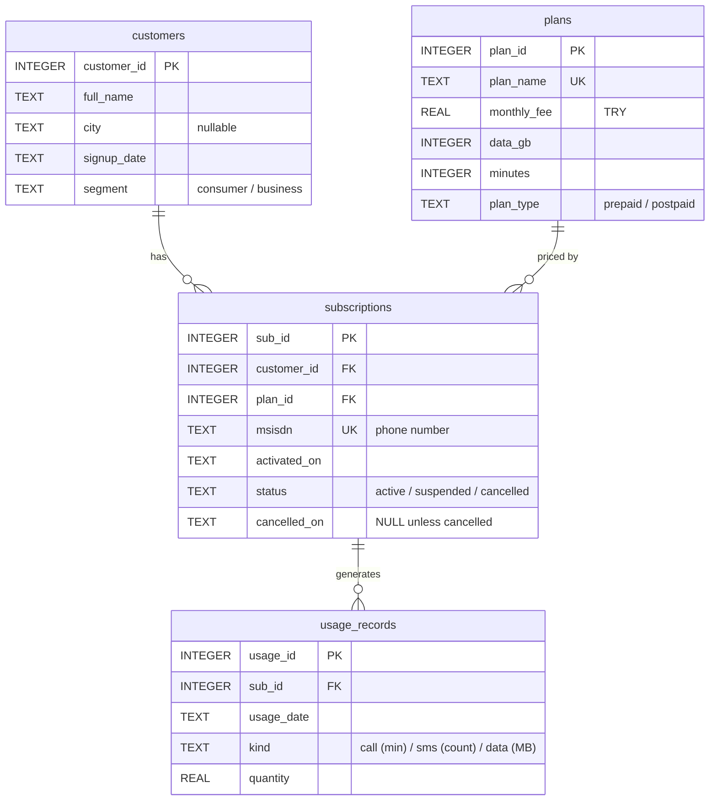

# TelcoDB: Mobile Subscriber & Usage Analytics (SQL)

A SQL portfolio project built on a **fictional** mobile-operator database: customers, plans, subscriptions and 50,000 usage records. It covers joins, aggregates, CTEs (including a recursive one) and window functions, with data-integrity checks.

> **All data is synthetic.** It is generated by a seeded script (`build_db.py`, seed 42). No real customer, phone number or operator data is used, and the project is not affiliated with any company.

## Quick start

Needs Python 3.8+ only (standard library, no installs).

```
git clone https://github.com/YOUR-USERNAME/TelcoDB-SQL.git && cd TelcoDB-SQL
python build_db.py
python run_queries.py
```

`build_db.py` creates `telco.db` from `schema.sql` plus generated data. `run_queries.py` runs every file in `queries/`, checks each query's row count against the `Expected rows` line in its header, and saves the full output to `results/`. Building twice produces identical data (fixed seed and a fixed "as of" date, 2026-09-30).

## Contents

```
schema.sql          tables, keys and CHECK constraints
build_db.py         seeded data generator -> telco.db
run_queries.py      runs queries/, verifies expected row counts, writes results/
queries/
  00_integrity.sql  orphans, duplicates, date sanity, PRAGMA foreign_key_check
  01_joins.sql      LEFT / INNER joins, anti-joins, a self-join
  02_aggregates.sql GROUP BY, HAVING, aggregate functions
  03_ctes.sql       CTEs, recursive CTE for a month calendar
  04_window.sql     LAG, running total, ROW_NUMBER / RANK / DENSE_RANK
results/            full output of every query
```

## Schema



Integrity rules in `schema.sql`: primary and foreign keys (enforced with `PRAGMA foreign_keys = ON`), unique phone numbers and plan names, `CHECK` constraints on categories, non-negative amounts and ISO date format, and a rule that a subscription is `cancelled` exactly when `cancelled_on` is set.

The generated data includes deliberate edge cases: customers with no subscription, cancelled and suspended lines, a plan with no subscribers, NULL cities, zero-usage records and lines with no usage at all.

## Definitions and assumptions

- **Revenue** is the plan's `monthly_fee` for each line billed in a month. There is no invoices table.
- **Billed in a month:** the line was active on any day of that month. Suspended lines count as billed, because the data has no suspension date.
- **Cancellation rate** for a month = lines cancelled that month / lines active at the start of that month.
- **Data allowance:** `data_gb * 1024` MB, compared with the monthly sum of `data` usage in MB.
- **"Active"** means `status = 'active'` as of 2026-09-30.
- Usage records are a sample of activity, not a complete call-detail log.

## Findings

These describe the synthetic dataset, not any real operator. Each number comes from the query noted, and the full output is in `results/`.

1. **Customers without an active line.** Of 1,000 customers, 100 have never had a subscription and 194 have no active one. The other 94 hold lines that are all cancelled or suspended. (`01_joins.sql` queries 3, 4 and 5)
2. **Plan mix.** Active subscribers per plan: Starter 330, Prepaid Lite 291, Plus 271, Prepaid Plus 202, Max 139. The Legacy 2019 plan has none. (`01_joins.sql` query 1)
3. **Data allowance overage.** Prepaid Lite lines went over their data allowance in 459 of 2,740 line-months with data (16.8%), the highest share. Max was lowest at 121 of 1,292 (9.4%). In September 2026, 60 lines exceeded their allowance. (`03_ctes.sql` query 4, `02_aggregates.sql` query 3)
4. **Cancellations.** The highest monthly cancellation rate was 1.97% in 2023-08 (4 of 203 lines active at the start of the month). In 2026-09 it was 0.4% (5 of 1,265). (`03_ctes.sql` query 2)
5. **Revenue by segment.** In 2026-09, business customers had 216 billed lines and 115,530 TRY of revenue, and consumers had 1,108 lines and 287,990 TRY. (`03_ctes.sql` query 1)

## Progress

- [x] Relational schema with primary/foreign keys, UNIQUE and CHECK constraints
- [x] Reproducible synthetic data generator (1,000 customers, 1,500 subscriptions, 50,000 usage records)
- [x] Integrity checks: orphans, duplicates, date sanity
- [x] Joins: INNER, LEFT, anti-joins, self-join
- [x] GROUP BY, HAVING and aggregate functions
- [x] CTEs, including a recursive CTE
- [x] Window functions: LAG, running total, ROW_NUMBER / RANK / DENSE_RANK

## Next

- [ ] Indexes and `EXPLAIN` on a larger generated dataset
- [ ] Migrate to PostgreSQL
- [ ] Add invoices and payments tables, and a suspension date, to replace the revenue assumptions above

## Tools

Python 3 (standard library), SQLite, DB Browser for SQLite.
